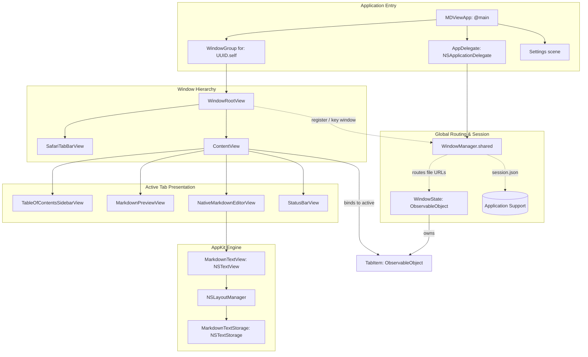
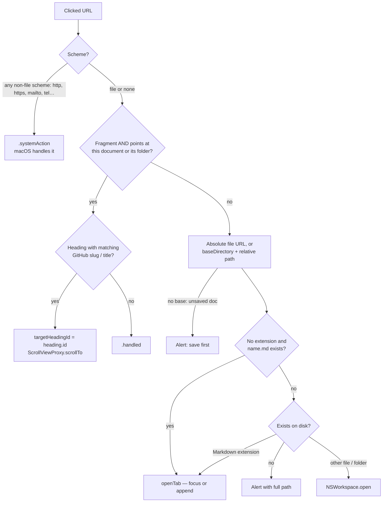

# MDView Architecture & Developer Guide

This document describes the technical architecture, state management and rendering pipelines of **MDView**. It is written for contributors and macOS engineers.

---

## 🏛 Table of Contents

1. [Design Philosophy](#1-design-philosophy)
2. [Component Architecture & UI Hierarchy](#2-component-architecture--ui-hierarchy)
3. [Tab & Window State Management](#3-tab--window-state-management)
   - [The Multi-Window Model](#the-multi-window-model)
   - [WindowManager & Active Window Routing](#windowmanager--active-window-routing)
   - [Notification-Driven Command Dispatch](#notification-driven-command-dispatch)
   - [Session Persistence & Restoration](#session-persistence--restoration)
   - [Unsaved Changes](#unsaved-changes)
4. [Link Interception & Path Resolution](#4-link-interception--path-resolution)
5. [AppKit Editor Integration](#5-appkit-editor-integration)
6. [Headings, Outline & Lazy Rendering](#6-headings-outline--lazy-rendering)
7. [Asynchronous Statistics](#7-asynchronous-statistics)
8. [Printing & PDF Export](#8-printing--pdf-export)
9. [Building & Tooling](#9-building--tooling)
10. [Extension Guidelines](#10-extension-guidelines)

---

## 1. Design Philosophy

Many Markdown editors are built on Electron and ship a full Chromium + Node.js runtime. MDView is instead a single native process:

| Aspect | Typical Electron editor | MDView |
| :--- | :--- | :--- |
| Processes | Main + renderer + GPU/utility helpers | One native process |
| Rendering | Blink web engine | SwiftUI / AppKit / Core Text |
| Text editing | JavaScript editor component | `NSTextView` + custom `NSTextStorage` |
| Platform integration | Re-implemented in JS | Native menus, Find bar, accessibility, Services, appearance |

**Why Swift 6 + SwiftUI + AppKit**

1. **Small footprint** — standard Cocoa objects instead of a browser engine; no JIT, no IPC.
2. **Fast startup** — no runtime to bootstrap before the first frame.
3. **Platform behaviour for free** — accent colours, Dark Mode, the responder chain, VoiceOver, the system Find bar and text services come with the native controls.
4. **Strict concurrency** — the package builds in Swift 6 language mode; all UI state is `@MainActor`-isolated and background work is limited to `Sendable` values.

---

## 2. Component Architecture & UI Hierarchy

SwiftUI handles windows, layout, bindings and toolbars; AppKit powers the text editor, panels, alerts and printing.



### Source map

| File | Responsibility |
| :--- | :--- |
| `MDViewApp.swift` | `@main` app, `AppDelegate` (Finder open, reopen, quit guard), menu commands |
| `Models/WindowState.swift` | `WindowManager` (routing, session), `WindowState` (tabs of one window), `DefaultsKey` |
| `Models/TabItem.swift` | One open document: text, file URL, dirty flag, per-tab view state, save logic |
| `Models/MarkdownFile.swift` | Supported extensions/UTTypes and tolerant (multi-encoding) file reading |
| `Models/MarkdownHeading.swift` | Heading parser, GitHub slugs, section splitting for lazy rendering |
| `Models/DocumentStatistics.swift` | Background word/character/line counting |
| `Models/PrintHelpers.swift` | `MarkdownPrinter` — paginated PDF rendering, print and PDF export |
| `Views/LocalImageProviders.swift` | MarkdownUI image providers that load `file://` images |
| `Views/WindowCloseInterceptor.swift` | Window delegate proxy that asks before closing a window with unsaved tabs |
| `Models/AppAppearance.swift` | Themes and `FontScale` zoom limits |
| `Views/NativeMarkdownEditorView.swift` | `NSViewRepresentable` editor, `MarkdownTextView`, `MarkdownTextStorage` |
| `Views/MarkdownPreviewView.swift` | Rendered preview, link interceptor, `Theme.nativeMac` |
| `Views/*` (others) | Window root, tab bar, content, outline, status bar, settings |

---

## 3. Tab & Window State Management

### The Multi-Window Model

Every window is an independent domain with its own tabs:

- Windows come from `WindowGroup(for: UUID.self)`; the UUID value identifies the window (and lets session restore re-open a specific window).
- `WindowRootView` creates its state from that identifier:

  ```swift
  init(windowID: UUID?) {
      self.windowID = windowID
      _windowState = StateObject(wrappedValue: WindowState(id: windowID ?? UUID()))
  }
  ```

- `WindowState` holds `@Published var tabs: [TabItem]` and `@Published var selectedTabId: UUID?`.
- Only the selected tab gets a `ContentView` (`.id(activeTab.id)`), so background tabs keep just their text and metadata — no text views, no layout caches.

### WindowManager & Active Window Routing

External events — a Finder double-click, a Dock drop, **File ▸ Open** — must reach the window the user is working in.

1. Every `WindowRootView` registers its `WindowState` on appear and unregisters on disappear (`openWindows`).
2. When a window becomes key (`controlActiveState == .key`) it becomes `WindowManager.shared.activeWindowState` (held **weakly**).
3. If no window exists yet (cold launch from Finder), URLs are queued in `pendingURLs` and a window is requested via `openNewWindowAction`. The new `WindowState.init` drains the queue, so no file is dropped.

```swift
func openURLsInActiveWindow(_ urls: [URL]) {
    guard !urls.isEmpty else { return }
    if let activeState = activeWindowState {
        for url in urls { activeState.openTab(url: url) }
    } else {
        pendingURLs.append(contentsOf: urls)
        openNewWindowAction?()
    }
}
```

`openTab(url:)` compares `standardizedFileURL`s, so a file that is already open is focused rather than duplicated.

### Notification-Driven Command Dispatch

Menu commands live at scene level (`MDViewApp.commands`), outside any window's view tree. They post notifications that every window observes; each window acts only if it is the key window:

```
[ Menu: ⌘T ] ──► NotificationCenter (.createNewTab)
                        │
                        ▼
          [ WindowRootView where controlActiveState == .key ]
                        │
                        ▼
              [ windowState.addNewTab() ]
```

```swift
.onReceive(NotificationCenter.default.publisher(for: .createNewTab)) { _ in
    guard controlActiveState == .key else { return }
    windowState.addNewTab()
}
```

### Session Persistence & Restoration

`WindowManager` saves the session whenever the tab structure changes (open, close, select, window register/unregister) and on `applicationWillTerminate`.

**Format** — JSON at `~/Library/Application Support/MDView/session.json`:

```swift
struct SavedSessionState: Codable { var windows: [SavedWindowState] }
struct SavedWindowState: Codable {
    var id: UUID                     // matches the WindowGroup value
    var tabs: [SavedTabState]
    var selectedTabURLString: String?
    var selectedIndex: Int
}
struct SavedTabState: Codable {
    var fileURLString: String?       // file-backed tab…
    var text: String?                // …or the full text of an Untitled draft
    var viewMode: String
    var selectedHeadingId: String?
    var scrollToOffset: Int?
}
```

Empty Untitled tabs are not stored; if nothing worth restoring remains, the file is deleted. Earlier builds stored the blob in `UserDefaults` (`saved_session_data`); it is migrated on first load and removed.

**Restoration flow**

1. The first `WindowState.init` calls `popSavedWindow(for:)`, which loads the session **once per launch** into `windowsToRestore` and hands out the entry whose `id` matches (or the first one).
2. That window's `onAppear` calls `restoreAdditionalWindows(using: openWindow)`, which opens one window per remaining entry — `openWindow(value: savedWindow.id)` — exactly once.
3. Each of those windows claims its own entry by id in its initializer.
4. Once the queue is empty, later windows (`⌘N`) start blank. Loading only once matters: re-reading the file after launch would clone the *current* windows into every new window.

Restored drafts are marked `isModified = true`, so closing them still asks before discarding text. Closing the very last tab in the app clears the session (the user explicitly emptied the workspace); closing the last *window* keeps it, Safari-style.

### Unsaved Changes

- `TabItem.text` has a `didSet` that sets `isModified` on any real change — typing, formatting shortcuts, drops — independent of which view is on screen.
- `WindowState.closeTab(id:)` asks *Save / Cancel / Don't Save* (`askToSaveChanges(of:)`). `TabItem.save(completion:)` reports success asynchronously, so an Untitled tab closes only after its save panel finishes successfully.
- `AppDelegate.applicationShouldTerminate` collects `WindowManager.tabsAtRiskOnQuit` (modified file-backed tabs, plus Untitled drafts when session restore is off) and offers *Save All / Cancel / Discard Changes*, using `TabItem.saveSynchronously()` because sheets cannot run during termination.
- Closing a window: SwiftUI owns the `NSWindow` delegate, so `WindowCloseInterceptor` (a zero-size `NSViewRepresentable` in the window's background) installs a `WindowDelegateProxy` that implements `windowShouldClose(_:)` and forwards every other delegate message to SwiftUI's original delegate via `responds(to:)` / `forwardingTarget(for:)`. It asks about `WindowManager.tabsAtRisk(onClosing:)` through the same `UnsavedChanges.resolve` prompt used on quit.

### Opening files from Finder

`WindowGroup` is declared with `.handlesExternalEvents(matching: [])`. Without it, SwiftUI creates a **new window for every** Finder *Open With* / `open -a` / Dock-drop event, and the AppDelegate then opens the file into that fresh window. With the scene opted out, the events reach `AppDelegate.application(_:open:)` only, which routes them to the active window. At a cold launch the event can arrive before the first window has registered; the URLs wait in `pendingURLs` and the window drains them in `onAppear` (`drainPendingURLs(into:)`). A lone pristine *Untitled* tab is replaced by the opened file.

---

## 4. Link Interception & Path Resolution

The preview uses [`swift-markdown-ui`](https://github.com/gonzalezreal/swift-markdown-ui) with `baseURL` set to the document's folder, and replaces the default link behaviour with a SwiftUI `OpenURLAction`:

```swift
.environment(\.openURL, OpenURLAction { url in
    handleLinkClick(url)
})
```

Because MarkdownUI resolves links against `baseURL`, a relative link such as `./GUIDE.md` arrives as an absolute `file://` URL, and an anchor `#setup` arrives as `file:///docs/#setup` (or bare `#setup` for an unsaved document). `handleLinkClick(_:)` triages them:



Notes:

- `isLinkToCurrentDocument(_:)` treats `#x`, `file:///dir/#x` and `file:///dir/this.md#x` as in-document anchors. Without it, an anchor in a saved document would resolve to the document's *folder* and open Finder.
- Fragments are percent-decoded before matching; matching tries the GitHub slug first, then the raw title, then the internal heading id.
- `.standardizedFileURL` collapses `.` and `..` segments before deduplicating tabs.

---

## 5. AppKit Editor Integration

### Why not `TextEditor`

SwiftUI's `TextEditor` does not expose the `NSTextStorage`, layout manager, selection APIs or key-equivalent handling needed for syntax highlighting and Markdown shortcuts. `NativeMarkdownEditorView` bridges AppKit's text system through `NSViewRepresentable`:

```
NativeMarkdownEditorView (NSViewRepresentable)
        │
        ▼
   NSScrollView
        │
        ▼
 MarkdownTextView : NSTextView   ◄── ⌘B / ⌘I / ⌘K / ⌘1-3, drag & drop, Find bar
        │
        ▼
  NSLayoutManager
        │
        ▼
 MarkdownTextStorage : NSTextStorage   ◄── paragraph-scoped highlighting
```

The coordinator pushes edits to the `TabItem.text` binding in `textDidChange`; `updateNSView` pulls external changes back, re-applies zoom/appearance, and performs programmatic scrolls requested by the outline (`scrollToOffset`).

### Paragraph-scoped highlighting

`MarkdownTextStorage` keeps its content in a backing `NSMutableAttributedString` and re-styles only the paragraph(s) touched by an edit:

```swift
override func processEditing() {
    if let highlighted = applySyntaxHighlighting() {
        // Widen the edited range to the whole re-styled paragraph so the layout
        // manager also redraws text before the cursor (e.g. the closing "*").
        edited(.editedAttributes, range: highlighted, changeInLength: 0)
    }
    super.processEditing()
}

private func applySyntaxHighlighting() -> NSRange? {
    let nsString = backingStore.string as NSString
    let totalLength = nsString.length
    guard totalLength > 0, editedRange.location != NSNotFound,
          editedRange.location <= totalLength else { return nil }

    let safeLocation = min(editedRange.location, totalLength - 1)
    let safeLength = min(editedRange.length, totalLength - safeLocation)
    let targetRange = nsString.paragraphRange(for: NSRange(location: safeLocation, length: safeLength))
    // reset base attributes, then apply the pre-compiled regexes within targetRange…
    return targetRange
}
```

Zoom or theme changes call `updateTypography(scale:appearance:)`, which marks the **whole** buffer as edited inside `beginEditing()` / `endEditing()`; `processEditing()` then re-highlights everything and the layout manager re-lays out with the new fonts.

**Cost:** each keystroke runs the regex set over one paragraph, so typing cost depends on paragraph length rather than document length. The trade-off is that constructs spanning paragraphs (e.g. fenced code blocks) are not highlighted as a unit.

### Key equivalents in `MarkdownTextView`

AppKit offers key equivalents to *every* view in the window, not only the focused one. `performKeyEquivalent(with:)` therefore acts only when the editor is the first responder and the modifiers are exactly ⌘ — so ⌘I in the preview of Split mode never edits the source, and ⇧⌘K or ⌥⌘I still reach the menu bar:

```swift
let modifiers = event.modifierFlags.intersection(.deviceIndependentFlagsMask)
guard modifiers == .command, window?.firstResponder === self else {
    return super.performKeyEquivalent(with: event)
}
```

Formatting goes through `shouldChangeText` / `replaceCharacters` / `didChangeText`, so it is fully undoable. Selection offsets are computed in UTF-16 (`NSString.length`) to stay correct with emoji and other non-BMP characters.

### Drag & drop and Find

- `performDragOperation` opens dropped Markdown/text files as tabs (via `onOpenFiles`) and turns dropped images into `` references, computing the path relative to `documentDirectory`; anything else falls back to `NSTextView`.
- `usesFindBar` and `isIncrementalSearchingEnabled` enable the system Find bar through the standard **Edit ▸ Find** commands.

---

## 6. Headings, Outline & Lazy Rendering

`MarkdownHeading.parse(from:)` is a single linear pass that:

- recognises ATX headings `#`–`######` (up to three leading spaces, optional closing `##`);
- skips fenced code blocks (```` ``` ```` / `~~~`, tracking fence character and length), so `# comment` in a shell snippet is not a heading;
- splits on the `\n` scalar so `characterOffset` is an exact UTF-16 offset, also for CRLF files;
- produces GitHub-compatible `slug`s with `-1`, `-2` … suffixes for duplicates.

`ContentView` parses once per render and passes the result to the outline and the preview(s). `MarkdownRenderSection.createSections` then cuts the document at heading offsets so the preview can render it in a `LazyVStack`, one `Markdown` view per section; each section's id equals its heading id, which is what `ScrollViewProxy.scrollTo` targets. Because headings inside code fences are ignored, a section boundary can never split a code block.

---

## 7. Asynchronous Statistics

```swift
.task(id: tab.text) {
    do {
        try await Task.sleep(nanoseconds: 120_000_000) // debounce typing bursts
    } catch {
        return // cancelled by the next keystroke
    }
    let calculated = await DocumentStatistics.calculate(for: tab.text)
    self.tab.statistics = calculated
}
```

1. `.task(id:)` cancels the pending computation whenever the text changes within the 120 ms window.
2. `DocumentStatistics.calculate(for:)` runs in a detached task off the main actor and returns a `Sendable` value.

---

## 8. Printing & PDF Export

`MarkdownPrinter` (in `PrintHelpers.swift`) produces one paginated vector PDF and uses it for both outputs:

1. `PrintableMarkdownContainer` lays the document out at the printable width with `Theme.nativeMac(forPrinting: true)`: fixed light colours, and code blocks that wrap instead of sitting in a horizontal `ScrollView` (scroll views render as empty space off-screen).
2. SwiftUI's `ImageRenderer` renders it once; inside `render { size, draw in … }` a `CGContext` PDF is created and, for every page, the tall rendering is translated and clipped so that page's slice lands inside the margins. Rendering runs under `NSAppearance(named: .aqua)` so dynamic system colours resolve to their light variants.
3. **Export** writes that data to disk; **Print** wraps it in a `PDFDocument` and uses PDFKit's `printOperation(for:scalingMode:autoRotate:)` with zero margins (they are already part of the pages).

The earlier approach — printing an `NSHostingView` with `NSPrintOperation` — silently dropped layer-backed content (code blocks, images, table borders) and could emit a trailing blank page.

### Local images

MarkdownUI's default providers load images through NetworkImage, which rejects anything that is not an HTTP 2xx response — so `file://` images never rendered. `LocalImageProviders.swift` adds `LocalFileImageProvider` (block images) and `LocalFileInlineImageProvider` (inline images) that read local files with `NSImage(contentsOf:)` and defer to MarkdownUI's defaults for remote URLs. Loading synchronously also means images are present when the PDF is rendered.

---

## 9. Building & Tooling

- **Package:** Swift Package Manager, `swift-tools-version: 6.0`, single executable target `MDView` (`Sources/MDView`), macOS 14+.
- **Info.plist** lives in `Sources/MDView/Resources/` and is *excluded* from the target; `scripts/build-app.sh` copies it into `build/MDView.app/Contents/` together with the release binary, ad-hoc signs the bundle and registers it with Launch Services.
- **Toolchain:** recent SDKs implement SwiftUI's `@State` as a macro whose implementation (`SwiftUIMacros`) ships with **Xcode**. With only the Command Line Tools active, `swift build` fails with *“plugin for module 'SwiftUIMacros' not found”*; select Xcode with `sudo xcode-select -s /Applications/Xcode.app` or set `DEVELOPER_DIR=/Applications/Xcode.app/Contents/Developer` (the build script does this automatically).
- **App icon:** `scripts/make-icon.swift` draws the icon with Core Graphics (blue → indigo gradient, paper sheet, Markdown "M↓" mark). It is **full-bleed**: macOS 26+ applies its own squircle mask and puts icons with transparent margins on a grey platter. Regenerate with:

  ```bash
  swift scripts/make-icon.swift /tmp/icon && iconutil -c icns /tmp/icon/AppIcon.iconset -o Sources/MDView/Resources/AppIcon.icns
  ```

  `Info.plist` references it via `CFBundleIconFile`, and `build-app.sh` copies it into `Contents/Resources`.
- **Tests:** `swift test` runs the `MDViewTests` target (Swift Testing, `@testable import MDView`): heading parser and slugs, section splitting, encodings, `TabItem` save/dirty state, statistics, zoom clamping, and PDF pagination/content via PDFKit. Tests avoid `WindowManager`, whose session file lives in the user's real Application Support folder.

---

## 10. Extension Guidelines

### Adding a syntax-highlighting rule

In `Views/NativeMarkdownEditorView.swift`, inside `MarkdownTextStorage`:

1. Add a pre-compiled static regex:

   ```swift
   private static let highlightRegex = try! NSRegularExpression(pattern: #"==(.+?)=="#)
   ```

2. Enumerate matches inside `applySyntaxHighlighting()`, limited to `targetRange`:

   ```swift
   Self.highlightRegex.enumerateMatches(in: nsString as String, options: [], range: targetRange) { match, _, _ in
       guard let match, match.numberOfRanges >= 2 else { return }
       backingStore.addAttribute(.backgroundColor,
                                 value: NSColor.systemYellow.withAlphaComponent(0.3),
                                 range: match.range(at: 1))
   }
   ```

Write to `backingStore` (not `self`) inside the highlighter; `processEditing()` already reports the re-styled range to the layout manager.

### Adding a setting

Add the key to `DefaultsKey`, register its default in `MDViewApp.init`, and read it with `@AppStorage(DefaultsKey.yourKey)`.

### Adding an export format

Follow `MarkdownPrinter`: build the content view, present an `NSSavePanel` as a sheet (falling back to `runModal()` when no window is key), and do the work on the main actor.
